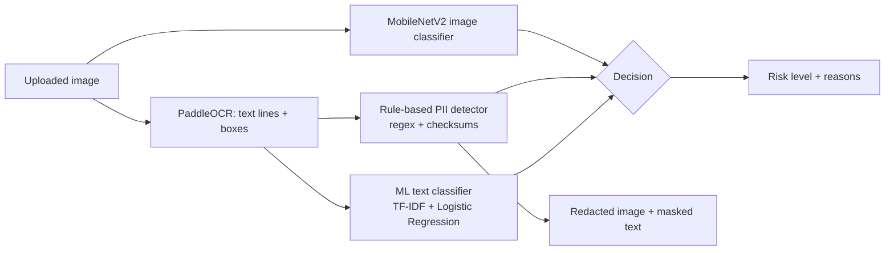

# Visual Privacy Risk Detector

**Live demo:** https://phanisrikanth9.github.io/sensitive_image_detection/ (runs entirely in your browser; images are never uploaded)

Upload images (screenshots, photos of documents, ID cards, chats) and the app tells you
whether they expose sensitive information, **why**, and gives back a copy with the
personal data blacked out.

## How it works



| Stage | What it does | Tech |
|---|---|---|
| Image classifier | Scores the whole picture as sensitive / not (looks like an ID card, document...) | MobileNetV2 pretrained on ImageNet, fine-tuned (transfer learning), TensorFlow/Keras |
| OCR | Reads the text in the image and where each line is | PaddleOCR (DB text detection + CRNN-style recognition) |
| PII detector | Finds credit cards, Aadhaar, PAN, SSN, phone numbers, emails, PINs/OTPs, passwords | Regular expressions **validated** with Luhn, Verhoeff, SSA and PAN rules |
| Text classifier | Catches sensitive *context* with no ID number ("password is...", diagnoses, "Confidential") | scikit-learn: word + character TF-IDF + PII/keyword features -> Logistic Regression |
| Decision | Sensitive if PII found **or** text score >= threshold **or** image score >= threshold | `analyzer.py` |
| Redaction | Black boxes over the PII inside each OCR line; text returned with PII masked | Pillow |

**Risk levels:** `high` = validated PII found, `medium` = a model flagged it but no PII matched, `low` = nothing found.

## Files

| File | Purpose |
|---|---|
| `index.html`, `web/` | The interface. On GitHub Pages it runs everything in the browser (Tesseract.js OCR, `web/engine.js` port of the rules + text model, TensorFlow.js image model). Served by `app.py` it sends images to the Python pipeline instead |
| `export_web_models.py` | Exports the trained models to `web/` for the browser version (rerun after retraining) |
| `app.py` | Flask web app (`/`, `/upload`, `/health`) - formerly `trail.py` |
| `analyzer.py` | The pipeline: image model, OCR, PII rules, text model, decision, redaction |
| `detectors.py` | Regex patterns, checksum validators, masking |
| `pattern_detector.py` | scikit-learn transformer that turns text into PII/keyword features |
| `generate_dataset.py` | Builds the synthetic text dataset (`data/text_dataset.csv`) |
| `train_text_classifier.py` | Trains + evaluates the text model, writes `models/text_metrics.json` |
| `train_image_model.py` | Trains the MobileNetV2 image model on a folder of images |
| `inference.py` | Command line: `--text "..."` or `--image file.jpg` |
| `tests/` | Unit tests for the detectors (`pytest -q`) |

## Setup

```bash
python -m venv .venv && source .venv/bin/activate     # Windows: .venv\Scripts\activate
pip install -r requirements.txt

# image model (15 MB, kept out of the repo): restore it from git history
mkdir -p models
git show 3658f2b:sensitive_model_final.keras > models/sensitive_model_final.keras

python generate_dataset.py            # optional: the dataset is already committed
python train_text_classifier.py       # optional: the trained model is already committed
python app.py                         # open http://127.0.0.1:5000
```

After retraining, run `python export_web_models.py` so the browser version uses the new models.
The JavaScript port is checked against Python: identical findings on 3,043 test texts and
image-model scores equal to 6 decimal places.

The app still starts if a component is missing (no TensorFlow, no OCR, no model file);
`/health` shows what is loaded.

## Results (text model)

Evaluated on **sentence templates the model never saw during training** (split by template,
not by row), with the threshold chosen on a separate validation set:

| Metric | GroupKFold 5-fold CV (thr 0.5) | Held-out test (thr 0.23) |
|---|---|---|
| Precision | 0.977 ± 0.047 | 1.000 |
| Recall | 0.947 ± 0.069 | 0.990 |
| F1 | 0.959 ± 0.043 | 0.995 |
| ROC-AUC | 0.998 ± 0.002 | 0.9999 |

Everyday numeric text (years, prices, order numbers, flight times) flagged: **0 / 14**
(the previous version flagged most of these, because any 4-digit number counted as an ATM PIN).

**Caveat:** the data is synthetic. These numbers show the method works on unseen wordings of
the same kinds of documents; they are not a measurement on real-world photos.

## Image model

`sensitive_model_final.keras`: MobileNetV2 (ImageNet) -> GlobalAveragePooling -> Dropout 0.5 ->
Dense(1, sigmoid); binary cross-entropy, Adam. Fine-tuned with the last 6 backbone layers
unfrozen at learning rate 1e-5. Trained on a public Kaggle dataset.
`train_image_model.py` reproduces this setup; expected layout:

```
image_data/{train,val,test}/{sensitive,non_sensitive}/*.jpg
python train_image_model.py --data image_data
```

## Privacy and security choices

- Uploads are processed in memory and never saved to disk
- The browser only receives OCR text with PII masked (`XXXX XXXX XXXX 1111`)
- Redaction uses solid boxes, not blur (pixelated text can sometimes be recovered)
- `secure_filename`, file-type allow-list, 16 MB upload limit, debug mode off by default
- OCR text is HTML-escaped in the UI (text inside an image could otherwise inject script)

## Known limitations

- Text model trained on synthetic data; real OCR output is noisier
- Redaction position inside a line is estimated from character offsets
- Names and addresses are not detected by rules (would need NER, e.g. spaCy)
- PaddleOCR must be imported before TensorFlow (handled in `analyzer.py`); the reverse order segfaults with current versions
